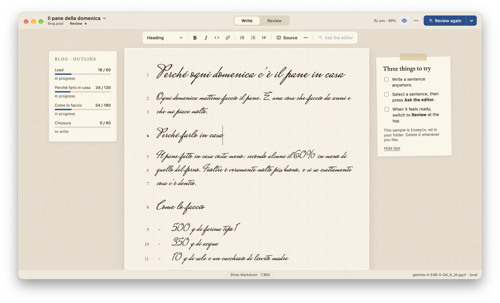

# Bluepencil

A local Markdown editor for articles, blog posts, reports and documentation, with an editor that
reads your text back to you. The editor is a language model running on your own network
(llama-server): it suggests a structure and reviews the text in four passes — structure, facts,
prose, grammar — but **it never writes for you**. Every suggestion is a note next to the page; it
goes into the text only when you click, and every change can be undone (⌘Z or **Undo**).

Your `.md` files are the real data. The SQLite index next to them is only a cache.

https://github.com/user-attachments/assets/58778e44-0551-4a18-92d9-1168089b64d2



## Requirements

- macOS, Node.js 22.18 or later, git.
- A llama-server on your local network. Optional: without it you can still write, but there is
  no structure or review.

## Quick start

```bash
git clone https://github.com/granvalenti76/bluepencil.git
cd bluepencil
npm install
```

Run it as a desktop app (Electron):

```bash
npm run desktop
```

Or in your browser (Safari or Chrome):

```bash
npm start
```

`npm start` builds the interface, starts the server on `127.0.0.1:4317` and opens a tab with an
access token in the address. Ctrl+C stops it.

**The first start** asks where your texts live (a new folder, `~/Documents/Bluepencil`, or one you
already use), tries the llama-server address (you can skip it) and opens a sample piece with three
things to try. It does not run again: change the folder and the model later in **Settings**.

In the desktop app, **Help ▸ Bluepencil Help** opens a short guide with all the shortcuts.

## How it works

1. **+ New** (in the drafts list, ⌘O; ⌘N in the desktop app): a title and, if you like, a type of
   text (Article, Blog post, Report, Documentation) and a language. Tick **Plan the sections
   first** to let the editor propose the sections from a topic and a goal.
2. **Write**: the Markdown hides while you type (⌥⌘M shows it), every line has its number, the bar
   above the page formats text and adds links, images, tables and sources. The outline next to
   the page shows each section against its target. Focus, Handwriting and Typing sounds are in the
   View menu. ⇧⌘P previews the text as a reader sees it.
3. **Ask the editor** on a selection: rephrase it (concise, clearer, smoother, creative) or check
   just that passage.
4. **Review** (⌃⌘N, or the switch at the top): the editor reads the whole text in four passes, one
   at a time. Each pass is a tab on the editor's card: a short letter, then numbered notes, with
   the same number pencilled on the page. **Finish pass** or **Skip** moves to the next one. The
   facts pass checks numbers, names and dates against your sources (files listed in `sources`
   or cited in footnotes).
5. **Sign-off**: once every pass is closed, the text gets its stamp. Editing the text lifts it.
6. **Publish…** (File menu): shows a diff, then copies a clean copy of the text (no editorial
   fields, no footnotes to local files) into your publish folder. If that folder is in a git
   repository, Bluepencil commits the file; it pushes only if you enable it and confirm.

## Setting up llama-server

Bluepencil does not start the model; it connects to a llama-server that is already running.
Example (adapt it to your model):

```bash
llama-server -m model.gguf --host 0.0.0.0 --port 8080 --ctx-size 32768 --jinja
```

Then set the address in **Settings**, e.g. `http://192.168.1.20:8080/v1`.

- The API must be OpenAI-compatible (`/v1/chat/completions` with streaming, `/v1/models`).
  `/props`, `/tokenize` and `/slots` are used when available.
- Reasoning models are expected: the reasoning stays on, is hidden, and the interface shows
  "thinking… (N tokens)". A full review on a slow model can take a while; you can cancel it.
- One slot is enough: Bluepencil sends one request at a time and reuses the prompt cache.
- Use a context of at least 16k tokens (32k or more is better for long texts).

`npm run probe` checks the configured server and writes timings and cache behaviour to
`docs/model-probe.md`.

## Configuration

Everything can be changed in **Settings** (the gear in the drafts list, or ⌘, in the desktop app).
Settings are saved in `~/.config/bluepencil/config.json`, which you can also edit by hand:

```json
{
  "draftsDir": "~/Documents/Bluepencil",
  "port": 4317,
  "model": { "baseUrl": "http://192.168.1.20:8080/v1" },
  "cloud": { "enabled": false, "baseUrl": "", "model": "", "apiKeyEnv": "BLUEPENCIL_CLOUD_KEY" },
  "publish": { "dir": "", "push": false }
}
```

- **`draftsDir`**: the folder of your texts. Every `.md` file is a text; a file cited by another
  one is a source.
- **`model.baseUrl`**: the llama-server address, including `/v1`.
- **`cloud`**: an optional fallback, used only when enabled. The API key is read from the
  environment variable named in `apiKeyEnv`, never from the file. The status bar always says
  "local" or "cloud".
- **`publish.dir`**: where **Publish…** copies the finished text. **`publish.push`**: also offer
  a git push (always asks first).
- A shared style guide can go in `<draftsDir>/.bluepencil/style.md`, one rule per line.

Useful environment variables: `DESK_DRAFTS_DIR`, `DESK_PORT`, `DESK_CONFIG` (another config file),
`DESK_MODEL_LOG=<file>` (log the model's reasoning, for debugging).

## Languages

Each draft has a language (`lang` in the front matter: `en` or `it`). It decides the language of
the editor's notes, the default sections and the readability index (Flesch for English, Gulpease
for Italian). You can add a language from **Settings ▸ Languages ▸ New language…** without
touching the code: see [docs/languages.md](docs/languages.md).

## Privacy

- The server listens only on `127.0.0.1` and requires a token.
- Nothing leaves your computer except requests to your llama-server, and to the cloud model only
  while you turn it on.
- Fonts are bundled; no CDN.

## Development

```bash
npm run dev           # server in watch mode + Vite on http://127.0.0.1:5173
npm test              # unit and integration tests (Vitest)
npm run test:e2e      # browser tests (Playwright, WebKit and Chromium)
npm run test:desktop  # desktop app tests (Playwright with Electron)
npm run lint          # ESLint + Prettier
npm run typecheck     # TypeScript, all packages
npm run eval          # evaluate the review passes against fixtures/eval
npm run measure       # memory and timings → docs/measures.md
```

The code is an npm workspace:

- `packages/core` — pure TypeScript: documents, front matter, sections, notes, language packs.
- `packages/server` — Fastify server: drafts, index, model client, review, publishing.
- `packages/web` — React + CodeMirror 6 interface.
- `packages/desktop` — Electron shell that runs the server as a separate process.

## Known limitations

- Deleting the index (`<draftsDir>/.bluepencil/index.sqlite`) loses no text or sources, but loses
  ignored notes, the check cache and word-count history.
- Web sources are not downloaded: copy what matters into a source file.
- In the browser, browser shortcuts (⌘W, ⌘R) still belong to the browser.
- The desktop app uses the system Node.js for its server: it is not yet a distributable package.
- Hemingway mode has a switch but does not block deletions yet.
- Typewriter scrolling works only together with Focus.
- No dark theme yet.

## License

[MIT](LICENSE) © 2026 Luca T. The bundled fonts keep their own licence (SIL Open Font License,
in `packages/web/public/fonts/`).
